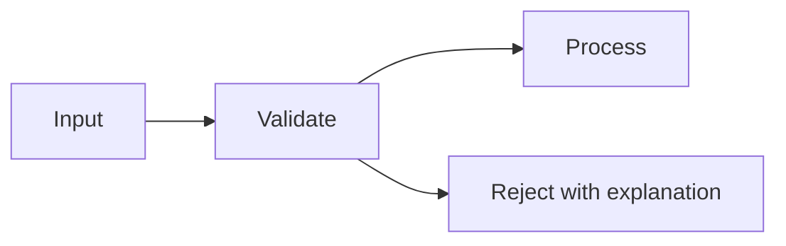

# Diagrams

Use a diagram when it clarifies relationships, data flow, lifecycle, or subsystem boundaries more directly than prose. It is optional.

## Required

Match every node and edge to the actual explanation. Distinguish an implemented path from a proposal, optional stage, compatibility route, or fallback. Do not draw a continuous successful pipeline when admission or artifact checks can reject a request. Keep labels consistent with the document's terminology.

Provide a short textual explanation so the diagram is not the only specification. A conceptual overview is not an exhaustive runtime contract. Link detailed lifecycle or algorithm information when needed.

## Mermaid versus image

Choose Mermaid for small maintainable flow/relationship diagrams. Choose a repository image for composed artwork, screenshots, or an existing maintained illustration. Do not add a rendering dependency merely to author one README diagram.

Illustrative syntax, not a verified TexasSolver execution graph:

Use legible labels and modest complexity. Label conditions when arrows could otherwise imply unconditional behavior. Check theme contrast and narrow layouts if rendering is performed; source inspection alone does not establish rendering correctness.

[GitHub's diagram guidance](https://docs.github.com/en/get-started/writing-on-github/working-with-advanced-formatting/creating-diagrams) explains supported Markdown diagram syntax. It is a previously collected authority, not newly checked here. [Prometheus](https://github.com/prometheus/prometheus#readme) and [containerd](https://github.com/containerd/containerd#readme) illustrate architecture images in technical introductions.
