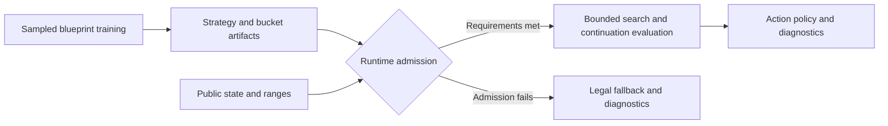

<h1 align="center">Texas Solver</h1>

<p align="center">
    
</p>
<p align="center">
  <a href="CMakeLists.txt">
    
  </a>
  <a href="CMakeLists.txt">
    
  </a>
  <a href="LICENSE">
    
  </a>
  <a href=".github/workflows/ci.yml">
    
  </a>
</p>

TexasSolver is a C++17 library for studying poker strategies and imperfect-information games. It provides small-game and Texas hold'em solvers, together with tools for training, evaluating, and using strategies. Its longer-term research direction is a bounded, CPU-oriented six-player no-limit hold'em system inspired by published descriptions of Pluribus.

> The project is an independent reconstruction, not the original Pluribus implementation. Its purpose is to make solver components and experiments available for research and integration, not to claim the results of either upstream project.

## What is available

- Kuhn and Leduc solvers for small-game experiments, including value and exploitability evaluation.
- Exact heads-up no-limit hold'em reference paths and sampled heads-up research infrastructure.
- Multiway game rules, blueprint training and artifacts, range tracking, bounded search, continuation evaluation, and policy export.
- Preflop equity tools, abstractions, and supporting utilities.

The multiway architecture has implemented training and runtime components, but a production-scale blueprint, calibrated settings, target-hardware resource budgets, and competitive playing strength remain unproven. Software checks alone do not establish convergence or low exploitability. See the [project guide](docs/PROJECT_GUIDE.md) and [progress log](docs/PLURIBUS_LOG.md) for context and dated evidence.

## How the multiway system fits together

This is a conceptual overview. A host supplies the artifacts and runtime dependencies required for a search; a legal fallback can be returned if search admission fails.



The host must provide verified full and compact blueprint artifacts, a matching bucket registry, a typed terminal leaf, solver limits, and a memory budget. The library does not parse the JSON release profile or provide a poker-client automation host. Consult the [project guide](docs/PROJECT_GUIDE.md#3-architecture-and-contracts) and [application and script I/O reference](docs/application_and_script_io.md) for the operational boundaries.

## Get started

You need CMake 3.20 or newer, a C++17 compiler and build tool, and the PokerHandEvaluator submodule. From the repository root:

```sh
git submodule update --init --recursive
cmake -S . -B build -DCMAKE_BUILD_TYPE=Release -DTEXASSOLVER_BUILD_EXAMPLES=ON
cmake --build build --config Release --target texas_solver_example
```

Run `build/examples/texas_solver_example` with a single-configuration generator, or `build/examples/Release/texas_solver_example.exe` with a typical Visual Studio generator. The example prints its iteration count, game value, and exploitability. It is a small-game demonstration, not a six-player strength measurement. Its source is [examples/solve_kuhn.cpp](examples/solve_kuhn.cpp).

To install the library after building it, choose an install prefix:

```sh
cmake --install build --config Release --prefix <install-prefix>
```

An installed-package consumer can use:

```cmake
find_package(TexasSolver CONFIG REQUIRED)
target_link_libraries(my_target PRIVATE TexasSolver::texas)
```

Set `CMAKE_PREFIX_PATH` to the install prefix when needed. Tests, examples, research targets, logging, and Tracy diagnostics are opt-in. See the [CMake and command guide](docs/PROJECT_GUIDE.md#5-cmake-structure) for options and package boundaries, and the [I/O reference](docs/application_and_script_io.md) for workflow inputs and outputs.

## Dependencies and tools

- [PokerHandEvaluator](https://github.com/HenryRLee/PokerHandEvaluator) is a required Git submodule for hand evaluation. Its [Apache 2.0 license](external/pokerHandEvaluator/LICENSE) applies to that dependency.
- Threads are required. Windows builds also link the system Cabinet library.
- Application logging is disabled by default. Enabling `TEXASSOLVER_ENABLE_LOGGING` requires [spdlog](https://github.com/gabime/spdlog) and [tomlplusplus](https://github.com/marzer/tomlplusplus). The internal logging target is not installed and is not a dependency of the installed main library. See the [logging guide](docs/texas_logging.md).
- [Tracy](https://github.com/wolfpld/tracy) is used by opt-in diagnostic targets and has its own [license](external/tracy/LICENSE). It is not listed as a Git submodule; the diagnostic build requires its source in `external/tracy`.
- The [scripts directory](scripts/) contains build, test, inspection, and experiment helpers. The [script catalog](docs/application_and_script_io.md#python-scripts) explains their inputs and side effects. `full_build.py` uses an existing configured build; it does not configure a fresh tree.

## Documentation

| Guide | Contents |
| --- | --- |
| [Project guide](docs/PROJECT_GUIDE.md) | Architecture, CMake options, commands, and working practices. |
| [Application and script I/O](docs/application_and_script_io.md) | Workflow targets, configuration, artifacts, and scripts. |
| [Logging](docs/texas_logging.md) | Logging configuration, sinks, categories, and progress reporting. |
| [Pluribus technical report](docs/pluribus_solver_technical_report.md) | Research background, design proposals, and references. Check its evidence labels when comparing proposals with current code. |
| [Progress log](docs/PLURIBUS_LOG.md) | Dated project work, verification, and limitations. |
| [AI workflow guide](docs/AI_WORKFLOW.md) | Repository instructions, skills, and how the progress log is used. |

The [API documentation workflow](.github/workflows/docs.yml) configures Doxygen generation and GitHub Pages deployment. A published Pages site has not been verified here; the workflow configuration alone does not establish a successful deployment or make every generated declaration a supported public API.

## Research background

- Brown and Sandholm, [Superhuman AI for multiplayer poker](https://doi.org/10.1126/science.aay2400) (2019), describes Pluribus and its reported results.
- Brown and Sandholm, [Solving Imperfect-Information Games via Discounted Regret Minimization](https://arxiv.org/abs/1809.04040), introduces discounted regret-minimization variants.

These papers provide background and inspiration; their findings are not validation of TexasSolver. The [technical report](docs/pluribus_solver_technical_report.md) contains further research references and design context.

## Contributing and license

Read [CONTRIBUTING.md](CONTRIBUTING.md) for contribution guidance and use [GitHub issues](https://github.com/ArtemIyX/TexasSolverLib/issues) for project issues. For reproducibility, include relevant configuration, inputs, and expected and observed behavior.

TexasSolver is distributed under the [MIT license](LICENSE). Third-party dependencies retain their own licenses.
